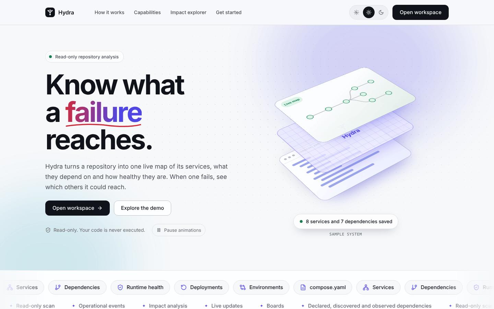
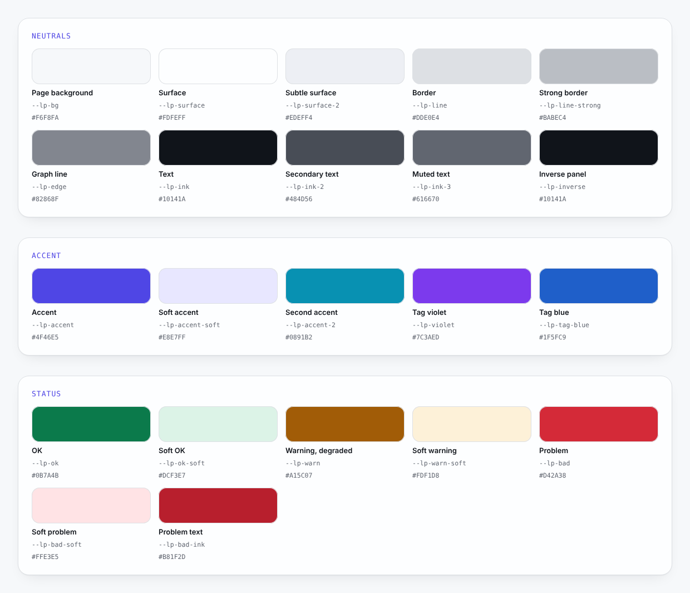
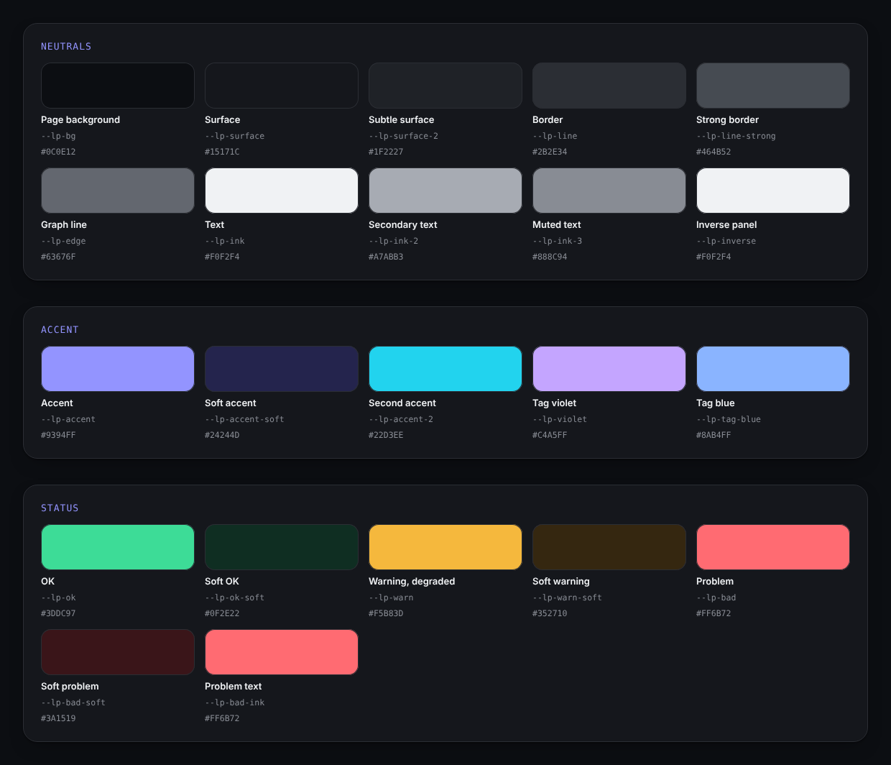
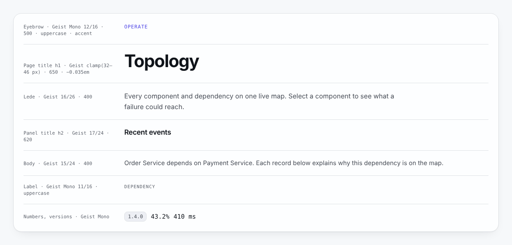
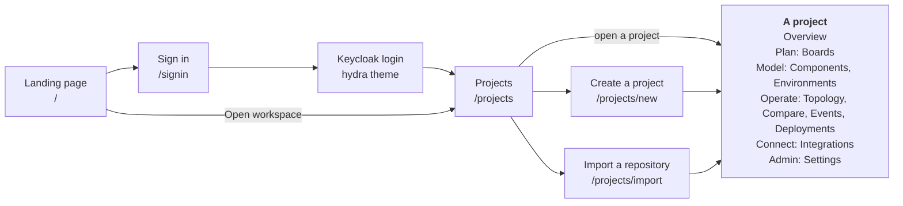
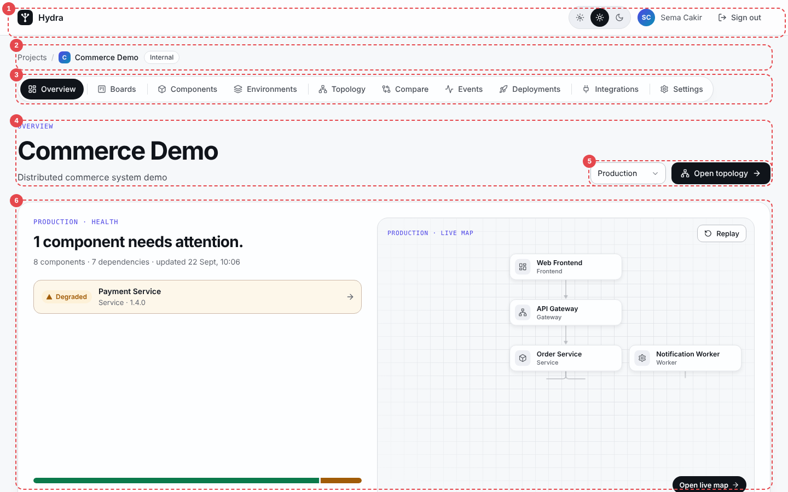
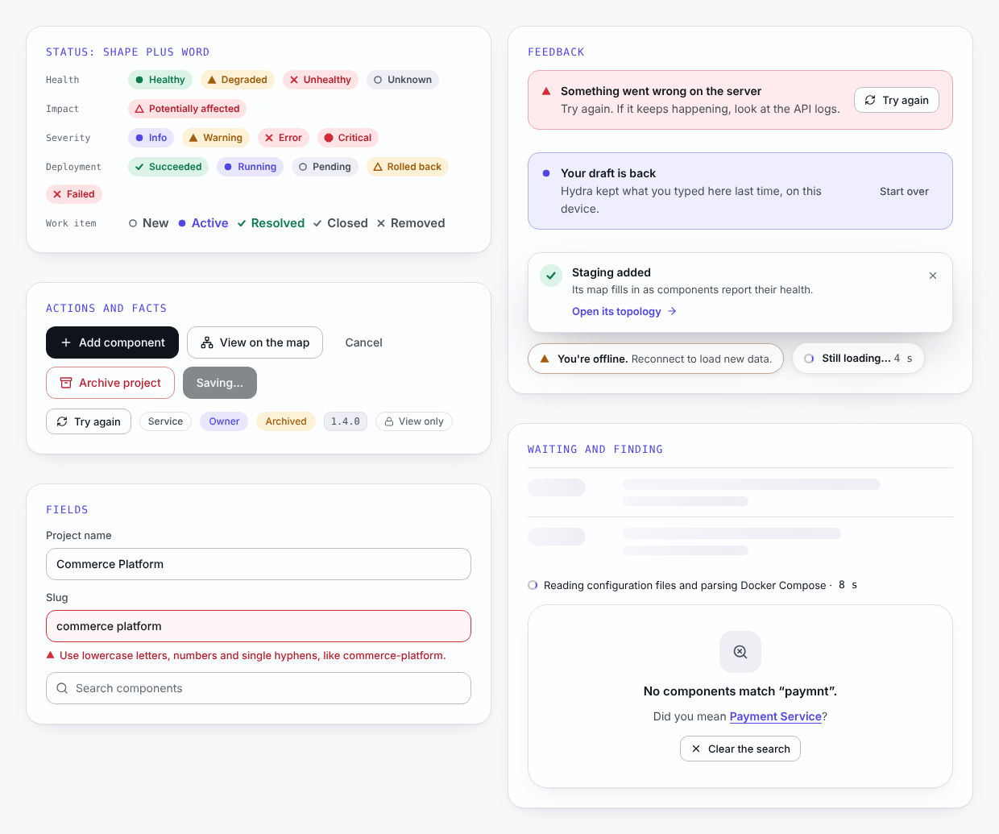
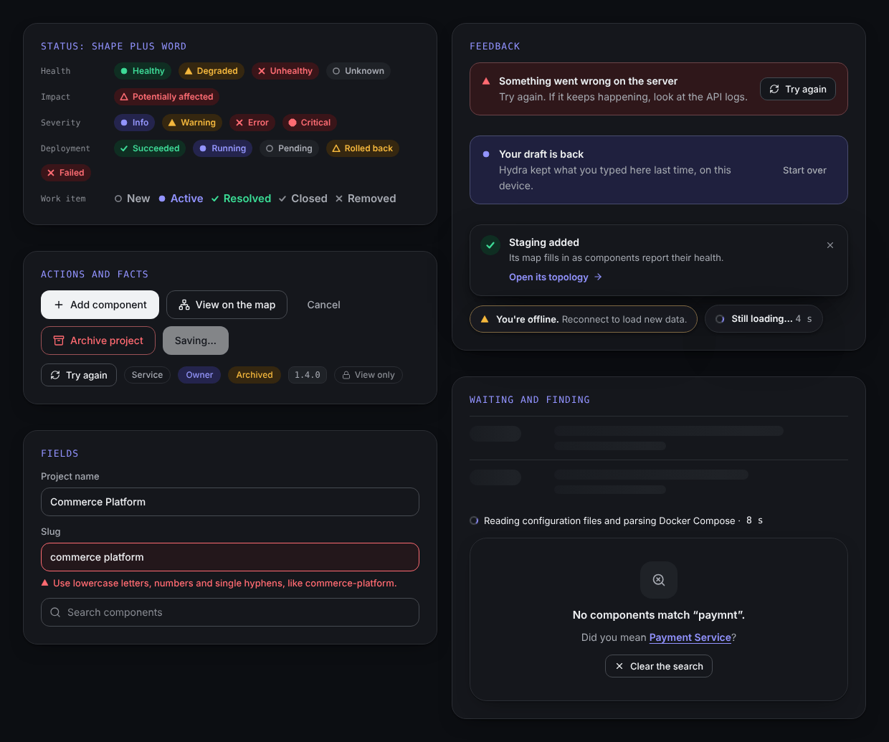

# Hydra

## Creative Design Brief

Version 1.0

### Revision History

| Date | Version | Description | Author |
| --- | --- | --- | --- |
| 31 October 2026 | 1.0 | First version, written from the implemented interface on the `feature/ui-redesign` branch. | Sema Cakir |

### Table of Contents

1. [Introduction](#1-introduction)
   1. [Purpose](#11-purpose)
   2. [Scope](#12-scope)
   3. [Definitions, Acronyms and Abbreviations](#13-definitions-acronyms-and-abbreviations)
   4. [References](#14-references)
2. [Overview](#2-overview)
3. [Visually Supporting the Function of the Site](#3-visually-supporting-the-function-of-the-site)
4. [Determining the Color Scheme](#4-determining-the-color-scheme)
5. [Fonts and Scrolling](#5-fonts-and-scrolling)
6. [Site Navigation and Page Layout](#6-site-navigation-and-page-layout)
7. [Graphics Standards](#7-graphics-standards)
8. [Browsers, Frames, and Other Standards](#8-browsers-frames-and-other-standards)
9. [Personalization Elements](#9-personalization-elements)
10. [Conclusion](#10-conclusion)

---

## 1. Introduction

### 1.1 Purpose

This Creative Design Brief sets the look and feel of the Hydra website. It describes the mood the site should create, and the colours, fonts, layout, graphics and standards that create it.

Designers and developers read it before they design or build a page. Reviewers use it to check that a page belongs to Hydra. The screens built with this style are shown in the [Design Comps / User-Interface Prototype](design-comps.md).

### 1.2 Scope

The brief covers every page people see:

- the public landing page (`/`);
- the sign-in page (`/signin`) and the Keycloak login pages (the `hydra` login theme);
- the signed-in workspace: the project list, creating and importing a project, and the ten tabs of a project (Overview, Boards, Components, Environments, Topology, Compare, Events, Deployments, Integrations, Settings).

It describes the interface as implemented in `frontend/web` (Next.js 15, React 19) on 31 October 2026. The API, the backend and the data itself are out of scope.

The product is called **Hydra** in everything people read. `DevOpsPlatform` remains only the working name of the code ([ADR 0020](../decisions/0020-product-name-hydra.md)).

### 1.3 Definitions, Acronyms and Abbreviations

| Term | Meaning |
| --- | --- |
| Component | One part of a distributed system on Hydra's map: a frontend, gateway, service, worker, database, cache, message broker or external service. |
| Dependency | A directed relationship between two components. An arrow from A to B means A depends on B. |
| Environment | A place where components run, such as Development or Production. Each environment has its own map, health, deployments and events. |
| Topology | The live map of an environment's components and dependencies. |
| Potentially affected | A component that depends, directly or through others, on a component with a problem. Hydra never says that it "will fail". |
| Sample system | Demo data, such as the services on the landing page and the Commerce Demo project. It is always labelled as sample. |
| Token | A named design value (a colour, radius, shadow or duration), stored as a CSS custom property such as `--lp-accent`. |
| Light, Dark, Auto | The three theme choices. Auto follows the visitor's local time. |
| Eyebrow | The short, uppercase, monospaced label above a title, in the accent colour. |
| Lede | The single sentence under a page title. |
| Panel, tile | The two containers of the workspace. A panel holds titled content (20 px corner radius); a tile is a larger summary card (24 px). |
| Pill, chip | A pill is a rounded label for a status or an action; a chip is a short fact, such as a type or a role. |
| Toast | A short message in the corner of the screen that confirms an action and offers the next step. |
| Skeleton | A grey placeholder in the shape of content that is still loading. |
| OIDC | OpenID Connect, the sign-in standard Hydra uses with Keycloak. |
| SSE | Server-Sent Events, which keep the topology and its events live. |
| WCAG | Web Content Accessibility Guidelines. Hydra aims at version 2.2, level AA. |

### 1.4 References

| Document | Where |
| --- | --- |
| Vision | [vision.md](../vision.md) |
| Design system, the developer reference for this brief | [design-system.md](../design-system.md) |
| Landing page | [landing.md](../landing.md) |
| Authentication and the Keycloak login theme | [authentication.md](../authentication.md) |
| ADR 0020: product name Hydra | [0020-product-name-hydra.md](../decisions/0020-product-name-hydra.md) |
| Design Comps / User-Interface Prototype | [design-comps.md](design-comps.md) |
| RUP example: Collegiate Sports Paging System, Creative Design Brief (the template of this document) | <https://files.defcon.no/RUP/examples/csports/ex_crdesbrf.htm> |
| Web Content Accessibility Guidelines (WCAG) 2.2 | <https://www.w3.org/TR/WCAG22/> |

## 2. Overview

Section 3 describes the mood Hydra should create and how the visuals support what the site does. Sections 4 to 7 describe the means: the colour scheme, the fonts and scrolling, the navigation and page layout, and the graphics standards. Section 8 lists the browsers and standards the site is built for, section 9 what each visitor can personalise, and section 10 concludes.

In one sentence: **Hydra should look calm, precise and honest — an operations tool that stays quiet while everything is fine, and shows clearly, in shapes and in words, what needs attention.**

Every value in this brief is taken from the code. If the brief and the code ever disagree, the code wins and the brief is corrected in the same change, the same rule as for [design-system.md](../design-system.md).

## 3. Visually Supporting the Function of the Site

Hydra gives a team one live map of a distributed system: its components, how they depend on each other, which version runs where, how healthy each one is, what changed recently and what a failure could reach. The planning work (stories, tasks, bugs) sits next to the components it changes. People open Hydra to answer a question quickly, sometimes in the middle of an incident. The public pages must explain all of this, in seconds, to a visitor who has never seen the product.

The mood follows from that function:

| Mood | What it means on screen |
| --- | --- |
| Calm | Few elements, generous space, neutral surfaces. Colour is kept for status, so a problem stands out by itself. Motion is slow and stops once it has told its story. |
| Precise | A strict grid, numbers and versions in a monospaced font, the exact time on hover, a word on every status, an arrow that always means "depends on". |
| Honest | Only what the product does today. Impact is "potentially affected", never a prediction. Sample data is labelled. Errors say what went wrong and how to fix it. |
| Premium | Large, confident type, soft depth (a frosted header, layered shadows) and smooth transitions: the feel of a well-made tool, without decoration. |
| Alive | The map is live. Health changes arrive without a reload, the "Live" dot pings, a scan counts its seconds. A wait always shows progress. |

How the visuals support the function:

1. **Status is a shape plus a word.** Each health state has its own shape (filled circle, triangle, cross, hollow circle) and its word, and the colour only reinforces them. A person with a colour-vision deficiency, or a grey-scale printout, reads the same thing.
2. **One idea per section.** A landing section has an eyebrow, a title, one sentence and one visual. A workspace page has one title, one sentence and one main task.
3. **Motion explains, it does not decorate.** On the landing page every animation shows something the product does: a compose file is read, a map is drawn, a failure travels back along the dependencies. In the workspace, motion is quieter still. All of it stops for visitors who prefer reduced motion.
4. **Every state of a page is designed.** Empty, loading, slow, failed, offline, no results, no access, session expired, a mistake in a form, and success each have their own screen ([Design Comps, Other Screens](design-comps.md#other-screens)).
5. **The words are part of the design.** Short sentences, second person, a verb first: "Import a repository", "Add an environment", "Clear the search".

*Figure 1: The landing page hero sets the mood: one claim, two actions, and a moving picture of what the product does, labelled as a sample system.*

## 4. Determining the Color Scheme

The scheme is a neutral grey-blue base, one indigo accent and three status colours. Every colour is a token in `frontend/web/src/app/globals.css`, with a Light set and a Dark set; the Keycloak login theme keeps a copy of the same values. No page uses a colour that is not a token.

### 4.1 Roles

- **Neutrals** carry the page: the background, two surfaces, two border strengths and three text strengths (text, secondary, muted).
- **Accent** (indigo, `--lp-accent`) marks interaction and position: links, the selected tab, the eyebrow, focus rings, a selected node on the map. Its soft tint fills selected and informational areas. A **second accent** (cyan, `--lp-accent-2`) is kept for gradients on the public pages.
- **Status colours** are used only for status: green for OK (healthy, succeeded), amber for warning (degraded, warnings, rolled back) and red for problems (unhealthy, errors, failures, potentially affected). Each has a soft tint for backgrounds, and red has a darker text shade for text on its tint.
- **Tag colours** (violet, blue and others) mark the labels people give to work items. They never mean a status.

### 4.2 Values

| Role | Token | Light | Dark |
| --- | --- | --- | --- |
| Page background | `--lp-bg` | `#F6F8FA` | `#0C0E12` |
| Surface / subtle surface | `--lp-surface` / `--lp-surface-2` | `#FDFEFF` / `#EDEFF4` | `#15171C` / `#1F2227` |
| Border / strong border | `--lp-line` / `--lp-line-strong` | `#DDE0E4` / `#BABEC4` | `#2B2E34` / `#464B52` |
| Text / secondary / muted | `--lp-ink` / `--lp-ink-2` / `--lp-ink-3` | `#10141A` / `#484D56` / `#616670` | `#F0F2F4` / `#A7ABB3` / `#888C94` |
| Inverse panel / text on it | `--lp-inverse` / `--lp-on-inverse` | `#10141A` / `#F8F9FC` | `#F0F2F4` / `#0D0F13` |
| Accent / soft accent | `--lp-accent` / `--lp-accent-soft` | `#4F46E5` / `#E8E7FF` | `#9394FF` / `#24244D` |
| Second accent (gradients) | `--lp-accent-2` | `#0891B2` | `#22D3EE` |
| OK / soft OK | `--lp-ok` / `--lp-ok-soft` | `#0B7A4B` / `#DCF3E7` | `#3DDC97` / `#0F2E22` |
| Warning, degraded / soft | `--lp-warn` / `--lp-warn-soft` | `#A15C07` / `#FDF1D8` | `#F5B83D` / `#352710` |
| Problem / soft problem / problem text | `--lp-bad` / `--lp-bad-soft` / `--lp-bad-ink` | `#D42A38` / `#FFE3E5` / `#B81F2D` | `#FF6B72` / `#3A1519` / `#FF6B72` |

The full list, with tag colours, shadows, radii and durations, is in [design-system.md](../design-system.md#tokens).

*Figure 2: The Light palette, drawn from the live tokens.*

*Figure 3: The Dark palette. Every role keeps its meaning; only the values change.*

### 4.3 Rules

1. The accent is for interaction, status colours are for status, tag colours are for tags.
2. Colour never carries meaning alone. Every status also has a shape and a word (section 7.4).
3. Text on an accent or inverse background uses `--lp-on-inverse`, which is light in Light and dark in Dark, so it keeps its contrast in both themes.
4. In the workspace, Degraded is amber, so degraded and unhealthy components can be told apart in one view. On the public pages the single failing service of the sample is red, with the services it may affect drawn as red outlines.
5. Every text colour reaches at least 4.5:1 against the background it is used on, in both themes (WCAG 2.2 AA). Measured examples:

   | Pair | Light | Dark |
   | --- | --- | --- |
   | Text on the page background | 17.4 : 1 | 17.2 : 1 |
   | Secondary text on a surface | 8.4 : 1 | 7.8 : 1 |
   | Muted text on a surface | 5.7 : 1 | 5.3 : 1 |
   | Accent on a surface | 6.2 : 1 | 6.8 : 1 |
   | OK text on its soft tint | 4.6 : 1 | 8.3 : 1 |
   | Warning text on its soft tint | 4.6 : 1 | 8.2 : 1 |
   | Problem text on its soft tint | 5.3 : 1 | 5.8 : 1 |

6. Depth comes from three shadow tokens (card, pop and stage, each with a Dark value) and from frosted surfaces: the workspace header and floating notices use `--lp-glass` with a background blur.

### 4.4 Themes

There are three choices: **Auto**, **Light** and **Dark**. Auto shows Light from 07:00 to 19:00 in the visitor's local time and Dark otherwise. A small script sets the theme before the first paint, so a page never flashes in the wrong theme. The choice is the same on the landing page, the sign-in page and the workspace; the Keycloak login pages follow the same rule but keep their own stored choice, because they run on another site.

## 5. Fonts and Scrolling

### 5.1 Typefaces

**Geist** is used for text and **Geist Mono** for code, numbers, versions, labels and eyebrows. Both are published under the SIL Open Font License. `next/font` downloads them when the site is built and serves them from Hydra's own origin, so no font request leaves the site; the Keycloak login theme bundles the same two fonts. If a font cannot load, the system interface fonts take over (`ui-sans-serif`, `system-ui`, Segoe UI, Roboto; `ui-monospace` for Geist Mono).

### 5.2 Type scale

| Use | Size / line height | Weight | Tracking |
| --- | --- | --- | --- |
| Page title on the landing page | `clamp(44px, 6vw, 80px)` / 1 | 650 | −0.045em |
| Page title on the sign-in pages | `clamp(38px, 4.4vw, 56px)` / 1.02 | 650 | −0.04em |
| Page title in the workspace | `clamp(32px, 3.4vw, 46px)` / 1.05 | 650 | −0.035em |
| Section title on the landing page | `clamp(34px, 4vw, 52px)` / 1.06 | 650 | −0.035em |
| Card or panel title | 17 to 34 px | 620 to 650 | −0.015 to −0.03em |
| Lede | 16 to 18 px / 26 to 30 px | 400 | normal |
| Body | 15 to 17 px / 24 to 28 px (the workspace uses 15 / 24 px) | 400 | normal |
| Eyebrow | 12 / 16 px, Geist Mono, uppercase, accent colour | 500 | 0.08em |
| Labels, badges, table headers | 10 to 13 px (headers in Geist Mono, uppercase) | 500 to 650 | normal to 0.08em |

*Figure 4: The workspace type scale, set with the real classes of the app.*

Rules:

- One `h1` per page, and heading levels never skip.
- Titles balance their lines (`text-wrap: balance`) and paragraphs avoid single words on the last line (`text-wrap: pretty`).
- Tight negative tracking is only for large titles.
- Numbers in tables and metrics are set in Geist Mono, so columns line up.
- Ledes stop at 680 px, about 80 characters, to stay easy to read.

### 5.3 Scrolling

- Pages scroll vertically only. No page scrolls sideways at any width from 375 px; this is checked in the browser at 1440, 768 and 390 px wide, in both themes.
- The workspace header stays at the top of the window (sticky and frosted), so the account and the theme switch are always within reach.
- On narrow screens the project tab bar scrolls sideways inside itself and keeps the current tab in view.
- Tables turn into a list of small cards on a phone instead of scrolling sideways.
- The topology map pans and zooms inside its own area (mouse, touch, the zoom and fit buttons, and a minimap); the page around it scrolls normally.
- The landing page scrolls smoothly to a section from the header links (instantly with reduced motion). In "How it works" the product window stays in view while the four steps scroll past it.
- Long lists are cut where the full list lives elsewhere: the topology shows the 8 latest events with a link to all events, and folds a long list of declared-only dependencies.

## 6. Site Navigation and Page Layout

### 6.1 Site structure

*Figure 5: The site map. Opening the workspace without a session leads to the sign-in page first.*

### 6.2 Navigation elements

| Element | Where | What it does |
| --- | --- | --- |
| Landing header | `/` | The brand, links to the four sections (How it works, Capabilities, Impact explorer, Get started), the theme switch and "Open workspace". |
| Workspace header | Every signed-in page | The brand (back to the project list), the theme switch, the avatar with initials and name, and Sign out. A "Skip to content" link comes first for keyboard users. |
| Breadcrumb | Every project page | Projects / project name, with the project's visibility. |
| Tab bar | Every project page | Ten tabs in six groups: Project (Overview), Plan (Boards), Model (Components, Environments), Operate (Topology, Compare, Events, Deployments), Connect (Integrations) and Admin (Settings). The eyebrow above a tab's title names its group (the Overview's simply says Overview). The bar stays in place while you switch tabs. |
| Deep links | Overview, Environments, Components | Open the topology on a chosen environment or component (`?environmentId=…&componentId=…`). |
| Next step | Toasts and empty states | Each success and each empty page offers the one action that comes next, such as "Open its topology" or "Add an environment". |
| A way back | Errors, no access, no results | "Try again", "Back to your projects", "Clear the search". No screen is a dead end. |

### 6.3 Page layout

Every workspace page has the same frame, so people always know where to look.

*Figure 6: The anatomy of a workspace page: (1) header, (2) breadcrumb and project facts, (3) tab bar, (4) page head with eyebrow, title and lede, (5) page actions, (6) content.*

| Rule | Value |
| --- | --- |
| Content width | Workspace up to 1440 px, landing page up to 1240 px |
| Side gutters | 32 px; 16 px on phones |
| Rhythm | Panels and tiles stacked with a 16 px gap. Landing sections 96 px apart (64 px on phones), with a section header of at most 720 px. |
| Columns | Two columns become one under 900 px. Card grids go from three columns to two under 1040 px and to one under 700 px. Figures that depend on their own width use container queries. |
| Corner radii | Workspace buttons 12 px, pills 999 px, panels 20 px, tiles and cards 24 px, windows 22 px, the sign-in picture and the closing panel 32 px |
| Topology | Toolbar above, the map on the left, the details panel on the right (below the map on narrow screens), recent events and dependency provenance underneath |
| Phones | One column, wrapping toolbars, a sideways-scrolling tab bar, tables shown as cards, notices across the full width |

## 7. Graphics Standards

### 7.1 Drawn, not pictured

Everything on the site is HTML, SVG and CSS. There are no photographs, no screenshots of the interface, no canvas and no animation library. Every graphic stays sharp at any zoom, follows both themes and weighs little. The product's own data (maps, status, numbers) is the only picture the workspace needs.

### 7.2 Brand

The Hydra mark is a small dependency tree, one root with three branches, on a rounded square of the inverse colour, followed by the word "Hydra". It sits at the top left of every page and links home: to the landing page from the public pages, to the project list from the workspace.

### 7.3 Icons

Icons are Lucide outlines (ISC licence), inlined as SVG: a 24-unit grid, a 2 px stroke with round ends, drawn at 12 to 22 px. They take the colour of the text next to them. An icon always comes with a word, except in buttons that have an accessible label (close, refresh, zoom); decorative icons are hidden from screen readers.

### 7.4 Status glyphs

Status has its own 12 px glyphs, so each state is recognisable by its shape:

| Kind | State | Shape | Colour |
| --- | --- | --- | --- |
| Health | Healthy | filled circle | OK |
| | Degraded | filled triangle | warning |
| | Unhealthy | cross | problem |
| | Unknown | hollow circle | muted |
| Impact | Potentially affected | hollow triangle, dashed outline | problem on its soft tint |
| Event severity | Info, Warning, Error, Critical | dot, triangle, cross, octagon | accent, warning, problem, problem |
| Deployment | Succeeded, Running, Pending, Rolled back, Failed | check, dot, hollow circle, hollow triangle, cross | OK, accent, muted, warning, problem |
| Work item | New, Active, Resolved, Closed, Removed | hollow circle, dot, check, check, cross | muted, accent, OK, muted, muted |

### 7.5 Maps and diagrams

- An arrow from A to B always means A depends on B. A failure travels against the arrows.
- The line style says where a dependency comes from: solid for declared, dashed for discovered (found by a repository scan), dotted for observed.
- A component on the map shows its type, version, name, health pill and, after an impact analysis, an "Affected · direct" or "Affected · indirect" pill.
- The maps on the public pages show a sample system and are labelled "Sample system".

### 7.6 Building blocks

*Figure 7: The building blocks of the workspace in Light.*

*Figure 8: The same building blocks in Dark.*

The building blocks, their code and when to use each one are listed in [design-system.md](../design-system.md#building-blocks-the-signed-in-app).

### 7.7 Motion

| Rule | Value |
| --- | --- |
| Purpose | Motion shows what the product does, or confirms what you did. Nothing moves only to move. |
| Properties | `transform` and `opacity`; small SVG stroke animations |
| Durations | Press 160 ms, interface changes 240 ms, entrances 500 to 900 ms, loops 5 to 12 s |
| Easing | `cubic-bezier(0.23, 1, 0.32, 1)` for entrances; a soft spring for pops |
| When | Animations start when they come into view and pause when they leave it. |
| Reduced motion | With "reduce motion" set in the operating system, every animation is removed and each graphic shows its most telling frame. The landing page also has a "Pause animations" button (WCAG 2.2.2). |
| Workspace | Quieter still: content rises in once, the overview's live map tells its story once, the impact path flows while it is shown, the "Live" dot pings three times, the loading bar crawls and then sprints to the end. |

## 8. Browsers, Frames, and Other Standards

### 8.1 Browsers

Hydra is built for the current versions of Chrome, Edge, Firefox and Safari, on desktops and phones. Its styles rely on CSS custom properties, `color-mix()` and container queries, so the oldest versions that show the design as intended are Chrome and Edge 111, Firefox 113 and Safari 16.2 (released between December 2022 and May 2023). A few refinements are progressive: `:has()`, `text-wrap: balance` and the crossfade when the theme changes (View Transitions). Browsers without them show the same page without the refinement.

The interface is checked in Chromium (Playwright) at 1440, 768 and 390 px wide, in Light and Dark: no sideways scrolling and no console errors.

### 8.2 Frames

Hydra uses no frames or iframes. It is one Next.js application: the landing page is prerendered as static HTML, and the workspace pages render in the browser and read the API. Sign-in happens on Keycloak, a separate site styled with the same design (the `hydra` login theme). The site loads no third-party scripts, trackers or embedded content, and serves its fonts itself.

### 8.3 Other standards

| Area | Standard |
| --- | --- |
| Markup | Semantic HTML: a header, navigation landmarks for the breadcrumb and tabs, one `main` per page (the target of the skip link), one `h1`, headings in order, `lang="en"`. |
| Accessibility | WCAG 2.2 AA as the target. Contrast as in section 4.3. Every action works from the keyboard, with a visible focus ring (2 px accent outline); the board offers a Move menu next to drag and drop. Status changes are announced (`role="status"` or `role="alert"`, live regions for toasts and connection notices). A field with a mistake is marked `aria-invalid` and linked to its message. Decorative graphics are hidden from screen readers. |
| Targets | Workspace buttons are 40 px high and small buttons 32 px, above the WCAG 2.2 minimum of 24 px. The landing and sign-in pages give their buttons and links a pressable area at least 44 px high. |
| Forms | The browser checks the rules written on each field (required, minimum and maximum length, pattern, email, number range). Hydra replaces the browser's bubble with a message under the field, in the same words on every form. |
| Dates and times | Shown in the visitor's own language settings and time zone, with the full date and time on hover. |
| Security in the interface | Passwords are typed only on Keycloak ("You enter your password on Keycloak. Hydra never sees it."). Repository files are read as plain text and never executed, and the interface says so. |
| Perceived speed | Placeholders in the shape of the content, a loading bar that sprints at the end, data fetched before a click, instant updates that the server confirms afterwards, and visible progress during long work. The details are in the [Design Comps](design-comps.md#other-screens). |

## 9. Personalization Elements

| Element | How it is personalised |
| --- | --- |
| Theme | Auto, Light or Dark, chosen with the switch in the header and remembered in this browser. The same choice applies to the landing page, the sign-in page and the workspace. |
| Motion | Follows the operating system's "reduce motion" setting. The landing page can also pause every animation. |
| Name and initials | The header shows the signed-in person's avatar initials and name. |
| Projects | The project list shows only the projects you are a member of. |
| Role | Owners, contributors and viewers see only the actions they may take. A "View only" chip explains why a form is missing. |
| Your work | The board can show only the work items assigned to you ("Assigned to me"). |
| Drafts | A new project or work item you are writing is kept on this device for up to 24 hours. When you come back, "Your draft is back" offers to continue or start over. |
| Where you were | After an expired session, signing in again returns you to the page you were on. |
| Language settings and time zone | Dates and times follow the browser's settings. |
| Links that remember | The topology opens on the environment and component named in its link. |

Not personalised in this version: the interface language (English only), the layout density and notification settings.

## 10. Conclusion

Hydra's style is one design language for every page: neutral surfaces, one indigo accent, three status colours that are always paired with a shape and a word, the Geist typefaces, a strict and generous grid, graphics drawn in SVG and CSS, and motion that explains. It is meant to feel calm when the system is healthy and to make a problem, and what it could reach, obvious at a glance.

The [Design Comps](design-comps.md) show the screens built with this brief, including every state of a page. When the style changes, update the tokens or classes in the code, [design-system.md](../design-system.md) and this brief in the same change.
